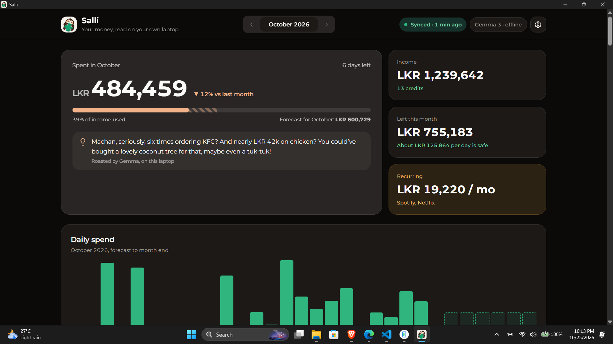
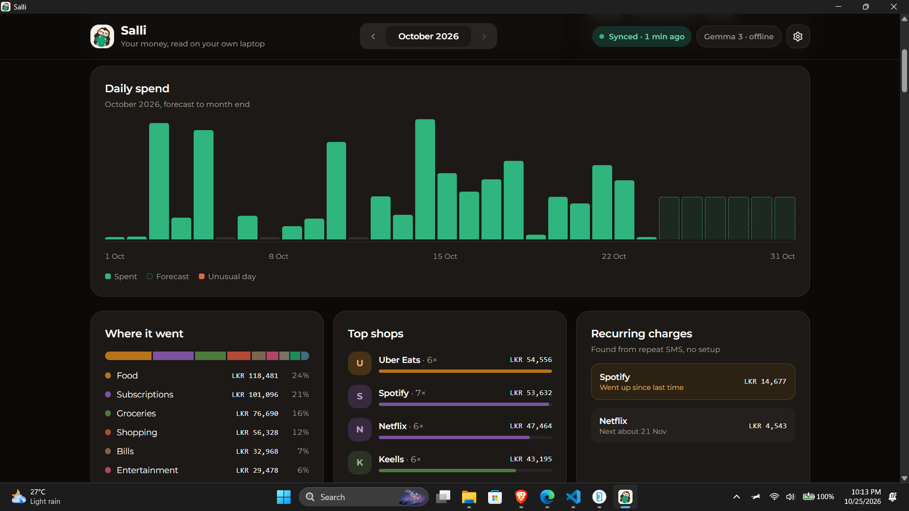
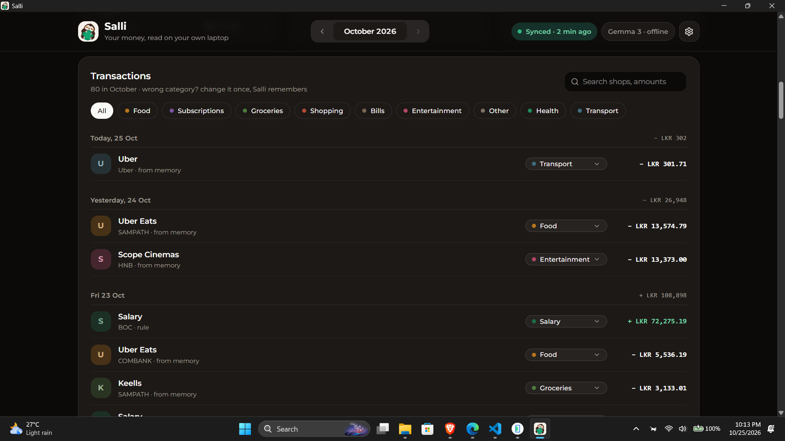
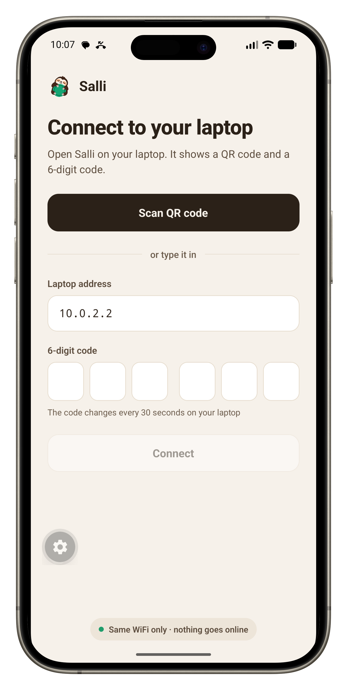
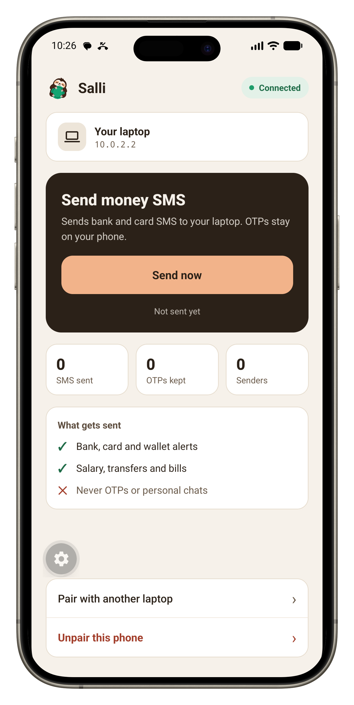
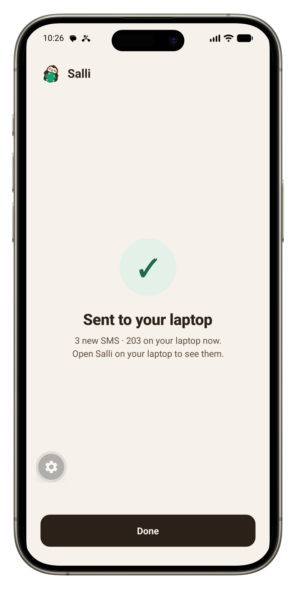
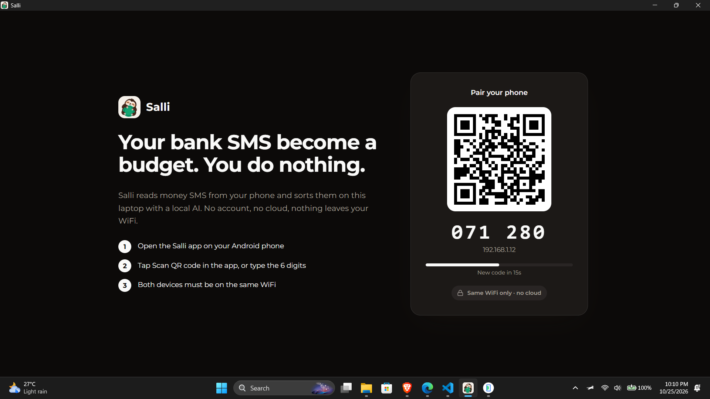
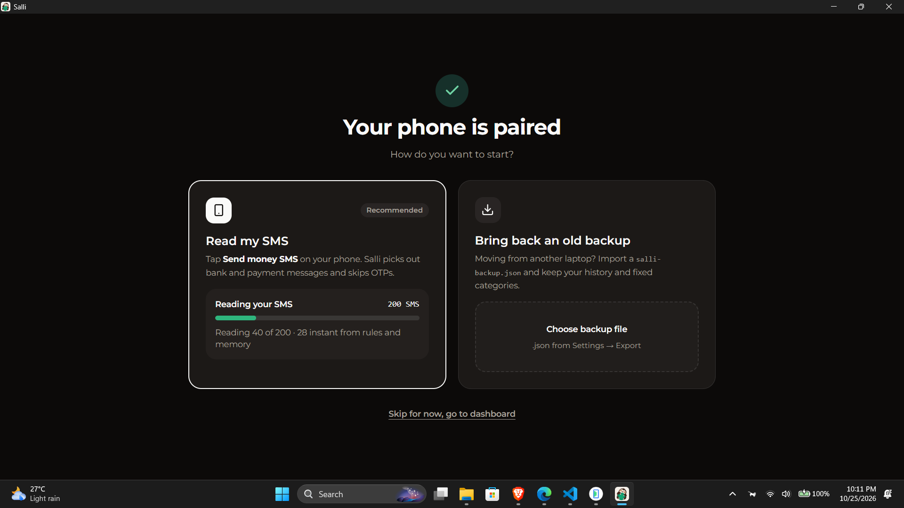
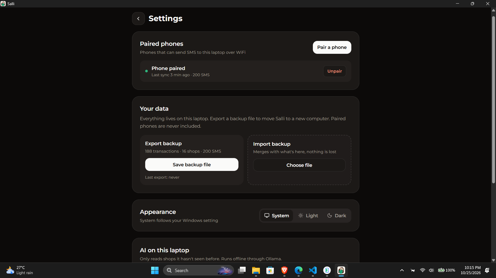

<p align="center">
  
</p>

<h1 align="center">Salli</h1>

<p align="center"><b>Your bank SMS become a budget. You do nothing.</b></p>

<p align="center">
  Salli reads the money SMS on your Android phone and turns them into a spending dashboard on your laptop,
  using Gemma running locally. No account, no cloud, nothing leaves your WiFi.
</p>

---

*Salli* (සල්ලි) means *money* in Sinhala. The mascot is a sloth because the whole point is that you stay lazy.

In Sri Lanka every card swipe, bill payment and salary credit already sends you an SMS. Budgeting apps want you to type all of that in again or hand your bank login to a cloud service. Salli just reads the SMS you already have.



## How it works

```
Android phone                          Your laptop (same WiFi)
┌──────────────────┐   QR pair    ┌──────────────────────────────────────┐
│ Salli app        │ ───────────▶ │ Salli desktop (Tauri + Rust)         │
│ reads SMS inbox  │              │                                      │
│ keeps bank SMS,  │  local HTTP  │  1. rules     regex for amounts      │
│ drops OTPs       │ ───────────▶ │  2. memory    shops it already knows │
└──────────────────┘              │  3. Gemma 3   only for new shops     │
                                  │        via Ollama, offline           │
                                  │                                      │
                                  │  dashboard · roast · forecast        │
                                  └──────────────────────────────────────┘
```

1. **Pair once.** The laptop shows a QR code and a 6-digit code that changes every 30 seconds. Scan it with the phone app.
2. **Tap Send now.** The phone keeps bank, card and wallet SMS, drops OTPs and personal chats, and sends the rest to your laptop over local WiFi.
3. **Salli reads them.** Rules pull out amounts first. Shops it has seen before come from memory. Only brand new shops go to **Gemma 3** running locally in Ollama, one SMS at a time with a strict JSON schema.
4. **Fix once, never again.** Change a wrong category and Salli remembers it for every future payment to that shop.

## What you get

- **Dashboard:** spent this month, income, what's left per day, daily spend chart, categories, top shops.
- **Recurring charges:** subscriptions found from repeat SMS, with a warning when one goes up.
- **Duplicate merge:** one payment often sends 3 SMS (bank alert, shop receipt, wallet). Salli keeps the bank's and folds the rest in.
- **A sloth roast:** Gemma writes one cheeky line about your month, from your real numbers.
- **Forecast:** where your month is heading. Uses TabPFN if you have it, a simple average if you don't.
- **Backup:** export everything to a JSON file and import it on a new laptop. Paired phones are never included.
- Light and dark mode, following your system.

## Screens





<p align="center">
  
  
  
</p>

<details>
<summary>Pairing, first sync and settings</summary>







</details>

## Privacy

- SMS go from your phone to your laptop over your own WiFi. There is no Salli server.
- Gemma and TabPFN run on your laptop. Your data is never sent to a model API.
- The phone app needs **SMS** permission to read the inbox and **camera** only for scanning the pairing code.
- Pairing uses a rotating 6-digit code and a token. Unpair from either side at any time.

## Run it

### Laptop

Install [Ollama](https://ollama.com) and pull Gemma:

```bash
ollama pull gemma3:4b
```

**Windows:** download `Salli_1.0.0_x64-setup.exe` from the [latest release](https://github.com/sasmeee/salli/releases) and run it. It isn't code-signed, so if SmartScreen warns you, click *More info → Run anyway*.

**Build from source** (any OS), with [Rust](https://rustup.rs) and [Bun](https://bun.sh):

```bash
git clone https://github.com/sasmeee/salli.git
cd salli/desktop
bun install
bun run tauri dev
```

Windows will ask to allow Salli on port 7777. Allow it on **private** networks so your phone can reach it.

### Phone (Android)

Download `salli.apk` from the [latest release](https://github.com/sasmeee/salli/releases) and install it.

Android protects SMS access, so apps that read SMS and don't come from the Play Store get blocked by Play Protect. To install:

- Turn off *Play Store → profile → Play Protect → Scan apps* for a moment, install, then turn it back on, **or**
- Install over USB with `adb install salli.apk`.

On Android 13+, if SMS permission says *restricted setting*, open *Settings → Apps → Salli → ⋮ → Allow restricted settings*.

To build it yourself:

```bash
cd salli/mobile
bun install
bunx expo prebuild --platform android
cd android && ./gradlew assembleRelease
```

### Optional: smarter forecast with TabPFN

Salli works fine without this. If you want the TabPFN forecast:

```bash
python -m pip install torch --index-url https://download.pytorch.org/whl/cpu
python -m pip install tabpfn
python desktop/src-tauri/forecast/forecast.py --setup
```

The setup step logs you in to Prior Labs once to accept the model license and downloads the weights (about 900 MB). After that it runs offline. Salli needs at least 14 days of history before it uses TabPFN.

## Benchmark

`tools/bench.ts` generates realistic Sri Lankan bank SMS with known answers and scores what Salli extracts.

| | Result |
|---|---|
| Amount, debit/credit, shop, category | 100% on the test set |
| Promos and OTPs skipped | 100% |
| Speed with Gemma 3 4B on a laptop CPU | about 0.6 to 0.7 s per new SMS |
| Read without calling Gemma (rules + memory) | most SMS once shops are known |

Honest note: some shops in the test set also appear as examples in the Gemma prompt, so real-world accuracy is lower. On my own real inbox, the misses were mostly receipts from billers being read as income, which the duplicate merge now handles.

## Built with

- **Desktop:** Tauri 2, Rust (axum, reqwest, regex), React, Vite, Tailwind, shadcn/ui
- **Phone:** Expo (React Native), a small Kotlin module for reading the SMS inbox and scanning QR (ZXing)
- **AI:** Gemma 3 4B via Ollama, TabPFN (optional)

## Known limits

- Android only. iOS doesn't let apps read SMS.
- Tested with Sri Lankan banks and billers. Other formats may need new rules.
- Phone and laptop must be on the same WiFi. Some office and guest networks block devices from seeing each other.

## License

Code is MIT. Gemma is under the Gemma Terms of Use. TabPFN weights are free for non-commercial use under the Prior Labs license.